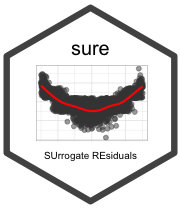

# sure 

[](https://CRAN.R-project.org/package=sure)
[](https://bgreenwell.r-universe.dev/sure)
[](https://github.com/bgreenwell/sure/actions/workflows/R-CMD-check.yaml)
[](https://app.codecov.io/gh/bgreenwell/sure)
[](https://cran.r-project.org/package=sure)

Surrogate residuals and diagnostics for ordinal and general regression
models, based on the approach of [Liu and Zhang
(2018)](https://doi.org/10.1080/01621459.2017.1292915).

- Surrogate residuals for cumulative link models from **MASS**,
  **ordinal**, **rms**, and **VGAM**, and for
  [`glm()`](https://rdrr.io/r/stats/glm.html) fits.
- Multinomial models and general classifiers via a matrix of predicted
  class probabilities.
- Latent-variable and jittering methods, with bootstrap replicates.
- Q-Q, residual-vs-fitted, and residual-vs-covariate plots built on
  **tinyplot**; no non-base hard dependencies.

## Installation

``` r

# From CRAN (recommended)
install.packages("sure")

# Latest development version, from r-universe
install.packages("sure", repos = c("https://bgreenwell.r-universe.dev", "https://cloud.r-project.org"))
```

## Quick start

``` r

library(sure)

# Simulate an ordinal response with a quadratic true relationship
set.seed(101)
df <- sim_data(n = 500, type = "quadratic")

# Fit a (misspecified) proportional odds model
fit <- MASS::polr(y ~ x, data = df)

# Compute surrogate-based residuals and plot the diagnostics
res <- resids(fit)
plot(res, what = "covariate", covariate = df$x, xlab = "x")
```

## Documentation

- Package website: <https://bgreenwell.github.io/sure/>
- Introductory vignette:
  [`vignette("sure", package = "sure")`](https://bgreenwell.github.io/sure/articles/sure.md)
- Greenwell, B. M., McCarthy, A. J., Boehmke, B. C., and Liu, D. (2018).
  Residuals and diagnostics for binary and ordinal regression models: An
  introduction to the sure package. *The R Journal*, 10(1).
  <https://doi.org/10.32614/RJ-2018-004>
- Liu, D. and Zhang, H. (2018). Residuals and diagnostics for ordinal
  regression models: A surrogate approach. *Journal of the American
  Statistical Association*, 113(522), 845-854.
  <https://doi.org/10.1080/01621459.2017.1292915>

## Development

`devel` is the default branch and holds ongoing development; `main`
holds stable releases only. Please open pull requests against `devel`
and report bugs at <https://github.com/bgreenwell/sure/issues>.
